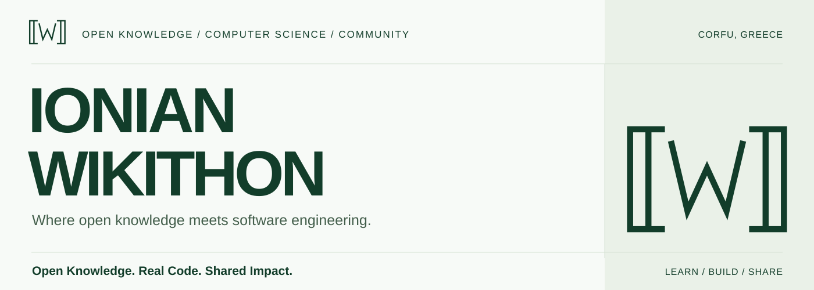
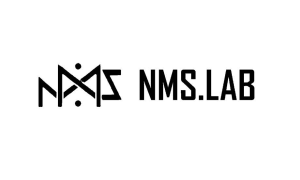
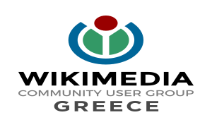
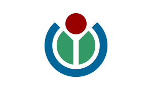
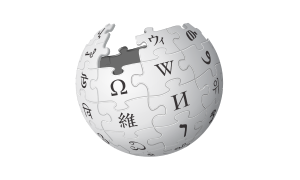

<picture>
  <source media="(prefers-color-scheme: dark) and (max-width: 600px)" srcset="https://raw.githubusercontent.com/Ionian-Wikithon/.github/main/assets/brand/banner-mobile-dark.svg">
  <source media="(max-width: 600px)" srcset="https://raw.githubusercontent.com/Ionian-Wikithon/.github/main/assets/brand/banner-mobile.svg">
  <source media="(prefers-color-scheme: dark)" srcset="https://raw.githubusercontent.com/Ionian-Wikithon/.github/main/assets/brand/banner-dark.svg">
  
</picture>

# Ionian Wikithon

**Open Knowledge. Real Code. Shared Impact.**

We connect computer science with the Wikimedia movement through hands-on learning, technical experimentation and collaborative knowledge. Based in Corfu, Greece, Ionian Wikithon brings students, educators, developers, researchers and volunteers together to learn and contribute.

[Explore](#user-content-explore) · [Learn](#user-content-learn) · [Our journey](#user-content-journey) · [Contribute](#user-content-contribute)

## From the classroom to the community

Our first official edition took place in 2022. Since then, the initiative has connected university teaching with Wikimedia pre-hackathons, Hackathon satellite events, technical workshops and contribution sessions.

The organizing collaboration brings together the **Networks, Multimedia and Systems Security Laboratory (NMSLab), Department of Informatics, Ionian University**, and **Wikimedia Community User Group Greece**. The [university's fifth-edition announcement](https://di.ionio.gr/gr/news/34573/) describes that continuing relationship.

Open knowledge needs people who understand both the information and the systems behind it. We make room to learn the tools, ask questions, write code and contribute alongside others.

## What we do

| Practice                         | In the workshop                                                                                           |
| -------------------------------- | --------------------------------------------------------------------------------------------------------- |
| **Technical learning**           | Guided exercises, demonstrations and time to work through unfamiliar tools together.                      |
| **Software and experimentation** | Exploring APIs, structured-data queries, localization and practical applications of Wikimedia technology. |
| **Collaborative knowledge**      | Learning to edit, document, query and connect contributions across Wikimedia projects.                    |
| **Community and education**      | Bringing classroom learning into contact with volunteer practice and the wider Wikimedia movement.        |

The [2023 program](https://www.mediawiki.org/wiki/Ionian_Wikithon_2023) offers a concrete example: Wikidata, SPARQL, software localization, Web2Cit and participant-led hacking time.

## Inside our GitHub

This organization is a place to share technical and educational work connected with Ionian Wikithon. The public collection is starting here, with this profile. **Workshop and software repositories are not public here yet.**

As material is published, this section will link directly to its source, instructions and learning context:

- **Workshop collections** - setup notes, exercises, slides, sample data and historical teaching materials.
- **Tools and experiments** - API demonstrations, Wikidata queries, scripts and prototypes, with their scope and maintenance status stated.
- **Community documentation** - practical guides, reusable explanations and contributions from participants.

[Browse public repositories →](https://github.com/orgs/Ionian-Wikithon/repositories?type=public)

For now, the official event programs and learning resources below are available without repository access.

## Workshops and learning

You do not need to arrive with a finished project. Start with a question, follow a worked example and keep a note of what you learn.

### Start with the ecosystem

Use the [Wikimedia Developer Portal](https://developer.wikimedia.org/) to find your way around the technical projects. The [MediaWiki contribution guide](https://www.mediawiki.org/wiki/How_to_contribute) explains ways to help with code, testing, documentation and translation.

### Revisit a workshop

The [2023 program and calendar](https://www.mediawiki.org/wiki/Ionian_Wikithon_2023) preserve session topics and the wider activity cycle. The [2026 program](https://el.wikipedia.org/wiki/Βικιπαίδεια:Ionian_Wikithon_2026) records the fifth edition's sessions. The programs are historical references; they are not complete downloadable course packages. The 2026 page is in Greek.

### Build something small

Follow the [Wikidata SPARQL tutorial](https://www.wikidata.org/wiki/Wikidata:SPARQL_tutorial) to explore structured knowledge, or try a read-only request using the [MediaWiki Action API documentation](https://www.mediawiki.org/wiki/API:Main_page). These are official learning resources, separate from Ionian Wikithon workshop repositories.

### Keep learning with others

The [Wikimedia Hackathon](https://www.mediawiki.org/wiki/Wikimedia_Hackathon) connects technical contributors across the movement. Bring a question or a documented experiment back to the community; an explanation that helps the next learner is a useful contribution too.

## Our journey

Five official editions, with activity beyond the main gathering. These references establish the edition dates and names; each annual cycle has its own wider context.

**2022 / The first connection** 
The inaugural Wikimedia pre-hackathon in Corfu took place on May 14, with a related Hackathon gathering on May 20. [University announcement →](https://di.ionio.gr/gr/news/23978/)

**2023 / Learning across communities** 
The May 29 edition connected local workshops with student experiences from the Athens Wikimedia Hackathon. [Program and calendar →](https://www.mediawiki.org/wiki/Ionian_Wikithon_2023)

**2024 / The city becomes a workshop** 
Ionian Wikithon - Ionian WikiSprint took place on May 15 as a Wikimedia Hackathon satellite event, supported by the Wikimedia CEE Hub. [University announcement →](https://di.ionio.gr/gr/news/30613/)

**2025 / The fourth edition** 
The May 9 gathering continued the collaboration as a Wikimedia Hackathon satellite event at the Department of Informatics. [University announcement →](https://di.ionio.gr/gr/news/32476/)

**2026 / Two days of practical work** 
The fifth edition took place on May 7-8, with Wikimedia tools and interactive application development on the announced program. [University announcement →](https://di.ionio.gr/gr/news/34573/)

## Powered by collaboration

  
  
  

**[Ionian University](https://ionio.gr/en/) / [Department of Informatics](https://di.ionio.gr/en/)** 
The academic setting for the initiative's teaching, technical learning and Corfu gatherings.

**NMSLab / Networks, Multimedia and Systems Security Laboratory** 
The organizing laboratory within the Department of Informatics. Its role is documented in the [university announcements](https://di.ionio.gr/gr/news/34573/).

**[Wikimedia Community User Group Greece](https://meta.wikimedia.org/wiki/Wikimedia_Community_User_Group_Greece)** 
The collaborating Wikimedia community organization, connecting the initiative with volunteer knowledge and contribution practices.

The Wikimedia CEE Hub is identified as a supporter of the [2024](https://di.ionio.gr/gr/news/30613/) and [2026](https://di.ionio.gr/gr/news/34573/) events. Support for a particular edition is distinct from the continuing organizing collaboration.

Ionian Wikithon participates in the Wikimedia ecosystem. This GitHub organization does not represent the Wikimedia Foundation or claim ownership of Wikipedia or other Wikimedia projects.

## Take part

Students and first-time contributors are welcome. Start by exploring the available resources and following a small example. You can contribute by explaining a confusing step, correcting documentation, reporting a problem, suggesting an improvement or sharing a relevant educational resource.

For this public profile, [open an issue](https://github.com/Ionian-Wikithon/.github/issues) with a clear suggestion or [propose a pull request](https://github.com/Ionian-Wikithon/.github/pulls). Historical corrections should include the original source. Help us keep links useful, language clear and institutional roles accurate.

For other repositories, follow their own contribution and licensing guidance. Maintainers may use a direct signed-commit workflow where write access has been granted. Publication and contribution rules can differ between projects.

For community activities, follow the announcements linked in [our journey](#user-content-journey) and the [Greek Wikimedia community's event coverage](https://blog.wikimedia.gr/tag/wikithon/). Historical registration links are not invitations to a current event.

## Useful resources

  
  

Wikimedia connects the wider movement; Wikipedia is one of its collaborative knowledge projects. These marks link to those resources.

| Develop and contribute                                                    | Explore the knowledge                                             |
| ------------------------------------------------------------------------- | ----------------------------------------------------------------- |
| [Wikimedia Developer Portal](https://developer.wikimedia.org/)            | [Wikidata](https://www.wikidata.org/wiki/Wikidata:Main_Page)      |
| [MediaWiki documentation](https://www.mediawiki.org/wiki/MediaWiki)       | [Wikimedia Commons](https://commons.wikimedia.org/wiki/Main_Page) |
| [Wikimedia Hackathon](https://www.mediawiki.org/wiki/Wikimedia_Hackathon) | [Wikimedia Meta-Wiki](https://meta.wikimedia.org/wiki/Main_Page)  |

Wikipedia logo: Wikimedia, Nohat (concept by Paullusmagnus), <a href="https://creativecommons.org/licenses/by-sa/3.0/">CC BY-SA 3.0</a>. <a href="https://commons.wikimedia.org/wiki/File:Wikipedia-logo-v2.svg">Original file</a> · <a href="https://github.com/Ionian-Wikithon/.github/blob/main/docs/LOGOS.md">All logo sources and credits</a>.

---

**A useful query. A clearer explanation. A first contribution.** 
What we learn together should remain useful to the next person.

[Explore the repositories](https://github.com/orgs/Ionian-Wikithon/repositories?type=public) · [Help improve this profile](https://github.com/Ionian-Wikithon/.github/issues)
